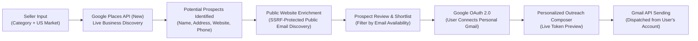

# BuyerFinder

A B2B prospect discovery and outreach platform for U.S. home-decor sellers.

---

## Overview & Problem Statement

Independent artisans, manufacturers, and small design studios often struggle to identify retail stores, lifestyle boutiques, and showrooms that might be interested in carrying their wholesale catalog. The traditional process is labor-intensive: manually searching map listings, sifting through individual business websites to find contact details, and managing outreach across multiple disparate tools.

**BuyerFinder** streamlines this entire workflow into a cohesive, structured pipeline: discovering commercial retail listings in target U.S. markets, inspecting their public websites for publicly listed business emails, curating a shortlist of potential prospects, and dispatching personalized wholesale inquiries directly through the seller's authenticated Gmail account via the Gmail API.

> **Important Factual Notice:** BuyerFinder identifies **potential prospects** and **prospective buyers** based on commercial category classifications and publicly available web information. It does **not** claim or guarantee buyer intent or purchasing commitments. BuyerFinder is an independent project and is not affiliated with, endorsed by, or an official product of Google, any government entity, or other organization.

---

## Core Workflow



1. **Search Input**: Seller enters their product/category (e.g., *Handmade ceramic tableware & vases*) and target U.S. market (e.g., *Austin, TX*).
2. **Live Business Discovery**: Google Places API (New) queries real-time commercial directories for relevant retail businesses.
3. **Prospect Identification**: The system parses verified listings, classifications, websites, and phone numbers.
4. **Public Email Enrichment**: Public business websites are safely inspected for publicly accessible contact emails and mailto links.
5. **Prospect Review**: Seller inspects prospect details, taxonomy classifications, and clear email availability indicators.
6. **Prospect Selection**: Seller curates a shortlist of prospects with available public emails.
7. **Gmail Authentication**: Seller securely connects their Gmail account via standard Google OAuth 2.0.
8. **Personalized Outreach**: Seller composes an outreach message with live preview tokens and dispatches emails via the Gmail API.

---

## Key Features

- **Live Commercial Discovery**: Powered by the Google Places API (New) Text Search for real-time commercial business discovery across U.S. locations.
- **Location & Category-Based Search**: Granular filtering by commercial category (home furnishings, gift & lifestyle boutiques, interior design showrooms).
- **Factual Relevance Summaries**: Contextual explanations derived from business categories and place metadata.
- **Public Website Email Enrichment**: Autonomous extraction of publicly listed business emails from official websites, protected by strict server-side SSRF validation.
- **Clear Contact Availability Distinctions**: Clear visual indicators distinguishing prospects with verified public emails from those requiring phone or direct website contact.
- **Prospect Shortlist Management**: Select, review, and organize potential prospects for outreach with persistent local storage.
- **Personalized Outreach Composer**: Template editor with real-time preview supporting variable interpolation (`{{businessName}}`, `{{location}}`, `{{sellerName}}`, `{{contactPerson}}`).
- **Google OAuth 2.0 Integration**: Secure Google OAuth authentication with zero password storage and least-privilege scope (`gmail.send`).
- **Gmail API Email Sending**: Dispatches personalized emails directly from the seller's authorized Gmail account with delivery status tracking.
- **Development-Only Test Recipient Mode**: Safe sandbox override for testing outreach deliveries to a designated test inbox (strictly disabled in production builds).
- **Local Session Management**: Sealed, encrypted HTTP-only session cookies using AES-256-GCM encryption.
- **Editorial Responsive Interface**: Fast, modern interface optimized for laptop, tablet, and mobile screens.

---

## Tech Stack

| Layer | Technology |
| :--- | :--- |
| **Framework** | [Next.js](https://nextjs.org/) (App Router, Turbopack) |
| **UI Library** | [React](https://react.dev/) |
| **Language** | [TypeScript](https://www.typescriptlang.org/) |
| **Styling** | [Tailwind CSS](https://tailwindcss.com/) |
| **Icons** | [Lucide React](https://lucide.dev/) |
| **Business Discovery** | [Google Places API (New)](https://developers.google.com/maps/documentation/places/web-service/op-overview) |
| **Authentication** | [Google OAuth 2.0](https://developers.google.com/identity/protocols/oauth2) |
| **Email Dispatch** | [Gmail API](https://developers.google.com/gmail/api) |
| **Runtime Environment** | [Node.js](https://nodejs.org/) |

---

## Architecture & Implementation Details

- **Server-Side Credential Isolation**: All API keys, Google Cloud OAuth client secrets, and session encryption keys are handled exclusively in Next.js server-side Route Handlers. No credentials or secrets are ever exposed to the browser bundle.
- **Authenticated Gmail Dispatch**: Outreach emails are never sent via generic third-party relay services. Instead, emails are dispatched directly through the authenticated user's own Gmail account via the official Google Gmail REST API (`https://www.googleapis.com/auth/gmail.send`).
- **Ethical Public Email Discovery**: Email enrichment exclusively fetches publicly accessible HTML content from official business websites listed on Google Places. It does not use unauthorized databases, data brokers, or web scrapers targeting restricted networks.
- **Factual Prospect Framing**: All prospect listings represent potential commercial retail prospects identified via directory classifications, not confirmed buyers.

---

## Project Structure

```text
BuyerFinder/
├── src/
│   ├── app/
│   │   ├── api/
│   │   │   ├── auth/google/          # OAuth initiation, callback, status, & disconnect
│   │   │   ├── outreach/send/        # Gmail API email dispatch route with validation
│   │   │   └── prospects/search/     # Google Places API discovery & email enrichment
│   │   ├── globals.css               # Editorial design tokens and typography
│   │   ├── layout.tsx                # Root layout with Geist font configuration
│   │   ├── page.tsx                  # Tab navigation (Discover, Prospects, Outreach)
│   │   └── providers.tsx             # Context provider wrapper
│   ├── components/
│   │   ├── HelpModal.tsx             # System architecture & workflow documentation modal
│   │   ├── Navbar.tsx                # Navigation bar with dynamic Gmail OAuth status
│   │   ├── OutreachView.tsx          # Template editor, live preview, test override & dispatch
│   │   ├── ProspectDrawer.tsx        # Slide-over detailed profile for individual prospects
│   │   ├── ProspectsView.tsx         # Curated prospect shortlist management
│   │   ├── ProspectTable.tsx         # Search results table with filtering and selection
│   │   ├── SearchForm.tsx            # Category and market location input form
│   │   └── SearchLoading.tsx         # Multi-step discovery progress indicator
│   ├── context/
│   │   └── AppContext.tsx            # Global state management (search, prospects, auth)
│   ├── lib/
│   │   ├── mockData.ts               # Isolated development sandbox fixture data
│   │   └── services/
│   │       ├── enrichment/
│   │       │   └── publicWebsiteEmail.ts # SSRF-safe public website email scraper
│   │       ├── gmail/
│   │       │   ├── auth.ts           # OAuth 2.0 authorization URL & token exchange
│   │       │   ├── crypto.ts         # AES-256-GCM session cookie encryption
│   │       │   └── send.ts           # RFC 2822 MIME message formatting & Gmail API send
│   │       └── googlePlaces.ts       # Google Places API (New) Text Search service
│   └── types/
│       └── index.ts                  # TypeScript definitions for prospects, search & email
├── .env.example                      # Template for required environment variables
├── package.json                      # Project dependencies and npm scripts
├── tsconfig.json                     # TypeScript compiler configuration
└── README.md                         # Project documentation
```

---

## Environment Variables

BuyerFinder requires the following environment variables configured in a local `.env.local` file:

```text
ENABLE_REAL_APIS
GOOGLE_PLACES_API_KEY
GOOGLE_OAUTH_CLIENT_ID
GOOGLE_OAUTH_CLIENT_SECRET
GOOGLE_OAUTH_REDIRECT_URI
GMAIL_SESSION_SECRET
```

| Variable | Description |
| :--- | :--- |
| `ENABLE_REAL_APIS` | Set to `"true"` to enable live Google Places and Gmail sending; set to `"false"` for mock development mode. |
| `GOOGLE_PLACES_API_KEY` | Server-side Google Maps Platform API key with **Places API (New)** enabled. |
| `GOOGLE_OAUTH_CLIENT_ID` | OAuth 2.0 Client ID generated in Google Cloud Console. |
| `GOOGLE_OAUTH_CLIENT_SECRET` | OAuth 2.0 Client Secret generated in Google Cloud Console. |
| `GOOGLE_OAUTH_REDIRECT_URI` | Authorized OAuth redirect URI (e.g. `http://localhost:3000/api/auth/google/callback`). |
| `GMAIL_SESSION_SECRET` | Optional 32-character encryption key for AES-256-GCM sealed session cookies. |

> **Security Note:** The `.env.local` file contains sensitive credentials and is strictly excluded by `.gitignore`. **Never commit `.env.local` or any secrets to source control.**

---

## Local Setup

### Prerequisites

- Node.js 18.17+ or 20+ installed
- npm or equivalent package manager
- A Google Cloud project with Places API (New) and Gmail API enabled

### Installation

1. **Clone the repository:**
   ```bash
   git clone <repository-url>
   cd BuyerFinder
   ```

2. **Install dependencies:**
   ```bash
   npm install
   ```

3. **Configure environment variables:**
   Copy the example environment file:
   ```bash
   cp .env.example .env.local
   ```
   Open `.env.local` and provide your Google Cloud credentials.

4. **Start the development server:**
   ```bash
   npm run dev
   ```

5. **Open the application:**
   Navigate to [http://localhost:3000](http://localhost:3000) in your browser.

---

## Google Places API Setup

1. Go to the [Google Cloud Console](https://console.cloud.google.com/).
2. Select or create a project.
3. Navigate to **APIs & Services** → **Library**.
4. Search for and enable **Places API (New)**.
5. Navigate to **APIs & Services** → **Credentials**.
6. Click **Create Credentials** → **API key**.
7. *(Recommended)* Restrict the API key to only authorize calls to the **Places API (New)**.
8. Add the key to `GOOGLE_PLACES_API_KEY` in `.env.local`.

*Note: Google Maps Platform usage and billing rules apply to live API requests.*

---

## Gmail OAuth 2.0 Setup

1. In the [Google Cloud Console](https://console.cloud.google.com/), navigate to **APIs & Services** → **Library**.
2. Search for and enable the **Gmail API**.
3. Go to **APIs & Services** → **OAuth consent screen**:
   - Choose **External** user type.
   - Fill in the required application details.
   - Under **Scopes**, add `https://www.googleapis.com/auth/gmail.send`.
   - Add your personal Gmail address to the list of **Test users**.
4. Go to **APIs & Services** → **Credentials**:
   - Click **Create Credentials** → **OAuth client ID**.
   - Select Application type: **Web application**.
   - Set **Authorized redirect URIs** to:
     ```text
     http://localhost:3000/api/auth/google/callback
     ```
5. Copy the generated **Client ID** and **Client Secret** into `.env.local`:
   ```text
   GOOGLE_OAUTH_CLIENT_ID=your_client_id
   GOOGLE_OAUTH_CLIENT_SECRET=your_client_secret
   GOOGLE_OAUTH_REDIRECT_URI=http://localhost:3000/api/auth/google/callback
   ```

---

## Security Architecture

- **Environment Isolation**: Secrets are loaded strictly server-side and never leaked via `NEXT_PUBLIC_` prefixes.
- **Git Protection**: `.env*` files (except `.env.example`) are ignored by Git.
- **Sealed Session Cookies**: Google OAuth refresh and access tokens are encrypted server-side using AES-256-GCM before being stored in an `httpOnly`, `sameSite=lax`, `secure` cookie. Tokens cannot be read by browser JavaScript.
- **SSRF Protection for Email Discovery**: The public website email crawler evaluates target URLs before fetching:
  - Validates protocol (only `http:` and `https:`).
  - Resolves domain names against DNS and blocks private IP ranges (`10.0.0.0/8`, `172.16.0.0/12`, `192.168.0.0/16`, `127.0.0.0/8`, link-local addresses, and cloud metadata endpoints).
  - Enforces strict request timeouts (5 seconds) and maximum response payload limits (250 KB).
- **Production Guard for Test Recipient Mode**: The development test recipient override is guarded by `process.env.NODE_ENV !== "production"`. In production builds, the test input is omitted from the UI and server-side overrides are strictly disabled.
- **Zero Password Storage**: BuyerFinder never requests, accepts, or stores Gmail passwords. Authentication relies solely on scoped OAuth 2.0 tokens.

---

## Important Limitations

- **Prospective Nature**: Search results represent potential commercial prospects, not confirmed buyers. BuyerFinder does not guarantee sales conversions.
- **Public Email Discovery Limits**: Contact enrichment only discovers emails that businesses have deliberately published on their official public websites.
- **Unpublished Contacts**: Some retail stores do not publish a public email address. These businesses are clearly marked in the UI and skipped during email dispatch, requiring manual phone or website contact.
- **Email Delivery**: Inbox placement, spam filtering, and delivery success depend on Gmail's deliverability policies and the recipient mail server.
- **Platform Availability**: Google Places API availability, rate limits, and pricing are subject to Google Maps Platform terms and policies.

---

## Demo & Hiring-Task Overview

This project was built as a comprehensive technical hiring-task demonstration showcasing:

- **Third-Party API Integration**: Live integration with Google Places API (New) for location-aware commercial business discovery.
- **Secure OAuth 2.0 Flow**: Standards-compliant authorization code exchange and AES-256-GCM sealed session management.
- **Direct Email API Sending**: Constructing RFC 2822 MIME payloads and sending through the official Google Gmail API.
- **Data Enrichment & Web Safety**: Server-side public email discovery with defense-in-depth SSRF protection.
- **State Management & UX**: Responsive Next.js application with TypeScript, persistent shortlist management, and real-time template interpolation.

---

## License

No license has been specified for this project.

---

## Author

**Sayed Saif Ali**
